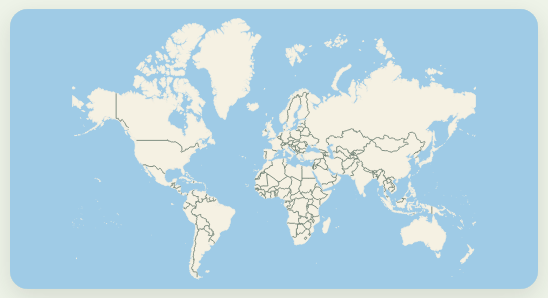
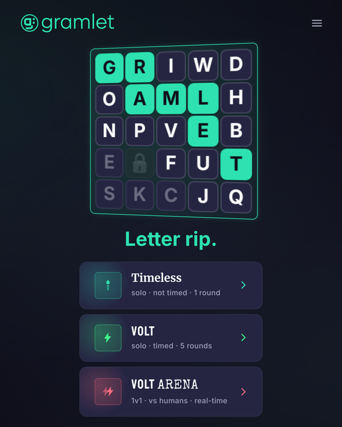
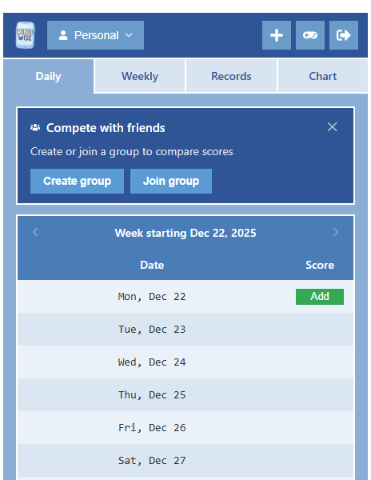
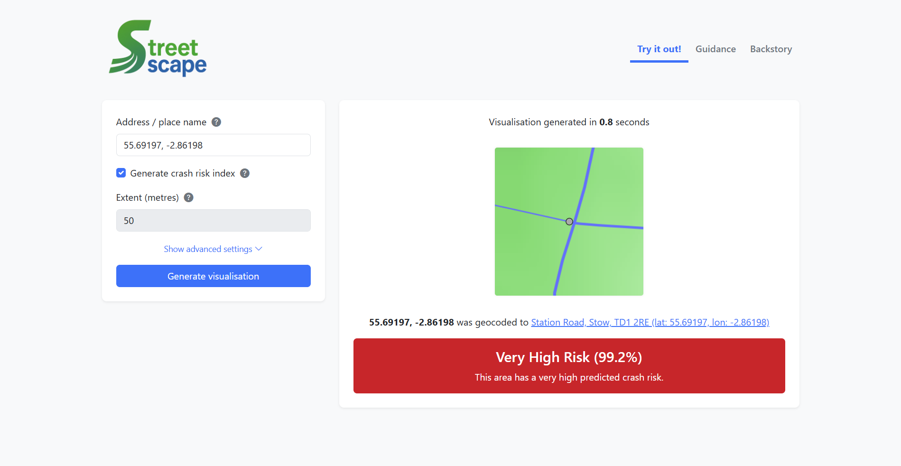
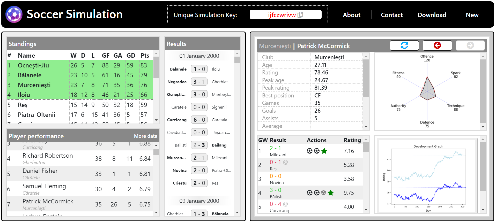
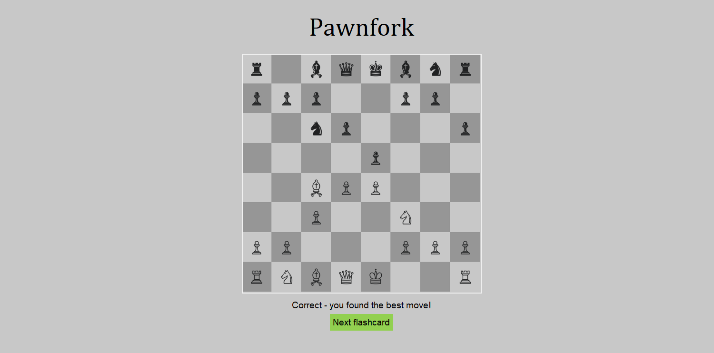
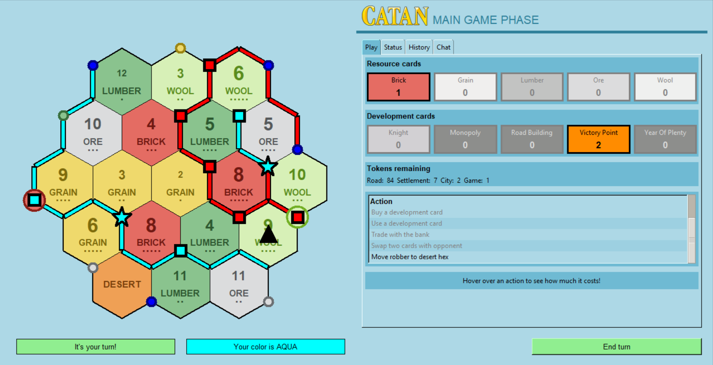
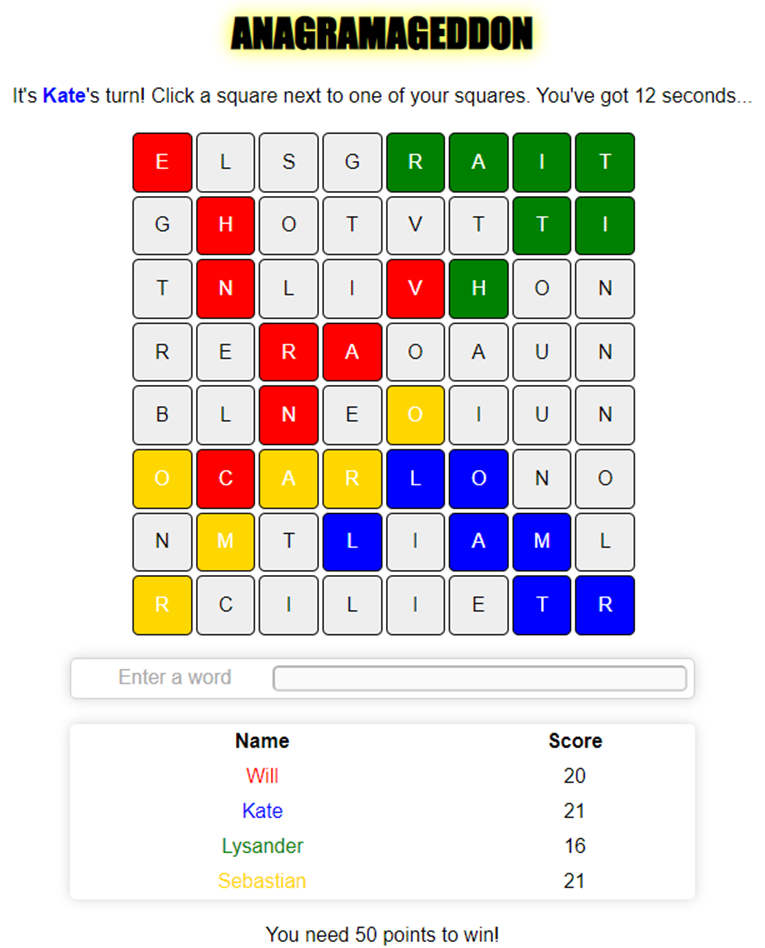

**Terraken**

Geography flashcards that grow outward from points you choose on the map.

[terraken.wjrm500.com](https://terraken.wjrm500.com)

Around ten thousand facts – where places are, what borders what, which rivers flow where, how places stand to each other – each scheduled by spaced repetition, so the ground you know spreads as fast as you learn it. Cards are drawn from real map geometry, and there’s a quick-fire city-tapping game on the side. No account needed, and it works offline.

**Gramlet**

A territory-control word game: claim a letter, spell a word, repeat.

[gramlet.co.uk](https://gramlet.co.uk)

Modes include Volt, a five-round sprint on an 8x8 grid; Timeless, a daily puzzle with a global leaderboard; VoltArena, real-time head-to-head matches against a friend; and Grambots, a single-player career league against bots. Built with React, Node.js and SQLite.

**WordleWise**

A Wordle score tracker.

[wordlewise.wjrm500.com](https://wordlewise.wjrm500.com)

Log your daily scores, form a group with friends and compete on leaderboards and records. Built in 2022 for my wife and me, and open to the public since December 2025.

Find out more:

-   [Using React to build a Wordle tracker](/2022/11/04/using-react-to-build-a-wordle-tracker)
-   [Land of Opus and glory](/2025/12/20/land-of-opus-and-glory)
-   [WordleWise UI/UX updates](/2025/12/23/wordlewise-ui-ux-updates)

**Streetscape**

A web app that draws colour-coded images of the road network and terrain around any point in Great Britain.

[streetscape.wjrm500.com](https://streetscape.wjrm500.com)

It exposes the image generator I built for my MSc research project, and can also run the crash risk model that project trained on its images.

Find out more:

-   [Behold, it’s the road network visualisation tool you’ve been waiting for](/2025/04/19/behold-its-the-road-network-visualisation-tool-youve-been-waiting-for)
-   [Streetscape now does more things than it did previously](/2025/04/29/streetscape-now-does-more-things-than-it-did-previously)

**Soccer Simulation**

A web app that allows you to run football simulations.

[soccer-sim.wjrm500.com](https://soccer-sim.wjrm500.com)

It’s very cool but kind of difficult to explain, so probably best to just give it a go. You can read a little more about the app [here](/2021/08/13/soccer-simulation-unveiled), and read more about my lifelong interest in football simulation [here](/2021/08/05/a-history-of-one-mans-inexplicable-obsession-with-football-simulation).

Find out more:

-   [Soccer Simulation unveiled](/2021/08/13/soccer-simulation-unveiled)
-   [Updates to Soccer Simulation](/2021/10/15/updates-to-soccer-simulation)
-   [Soccer Simulation: creating the team formation graphics](/2021/11/26/soccer-simulation-creating-the-team-formation-graphics)

**Pawnfork**

An app for memorising chess openings.

[Download Pawnfork (zip)](/wp-content/uploads/2022/08/Pawnfork.zip)

Another Tkinter app, this one rather simpler in conception and execution, but a labour of love nonetheless. The flow is simple:

1.  Generate batches of flashcards – select which opening you want to study, which colour you want to play as, how deep into the position you want to look, and how much variation you want to consider in your opponent’s play
2.  Study those flashcards – you will be presented with relevant chess positions and asked to find the optimal move (according to the Stockfish chess engine) in each of those positions

Find out more:

-   [Optimise your chess opening play with the help of my new app](/2022/08/12/optimise-your-chess-opening-play-with-the-help-of-my-new-app)
-   [6 talking points from Pawnfork](/2022/08/22/6-talking-points-from-pawnfork)

**Catan**

You know the board game Catan? It’s like that, but a digital version.

[Download Catan (zip)](/wp-content/uploads/2022/03/wjrm500_Catan.zip) · [download guide](/catan)

Written in Tkinter and playable across multiple computers on the same network, it was a project that took months and taught me a lot about GUIs and networking. Read the story behind the app [here](/2022/03/10/a-catan-love-story).

## Retired

**Anagramageddon**

A 2-4 player, browser-based game in which players on a single device take it in turns to select adjacent letters and find words that can be formed with their existing letters.

_Update: Anagramageddon is no more! It has grown into [Gramlet](https://gramlet.co.uk), at the top of this page_

Built using React.

Find out more:

-   [Anagramageddon: fight for territory and find anagrams as you battle against the clock](/2022/12/08/anagramageddon-fight-for-territory-and-find-anagrams-as-you-battle-against-the-clock)

**Planit**

A mobile-first app for finding the best place to meet your friends.

_Update: Planit is no more! The company was closed in December 2022, and resources such as the website (planitapp.co.uk) are no longer available_

The app leverages Google APIs and a proprietary algorithm to return lists of venues to the user. Although I was involved in designing the UI through mock-ups and group discussions, the actual frontend implementation was done using React by a Leicester-based agency called Bulb. My primary role in this project was developing the backend, which involved server hosting, creating an API for the frontend, integrating with external APIs, converting the original single-file script containing the core algorithm into robust and maintainable application code, optimising this code for performance, adding support for new features, and integrating the application with a database.

